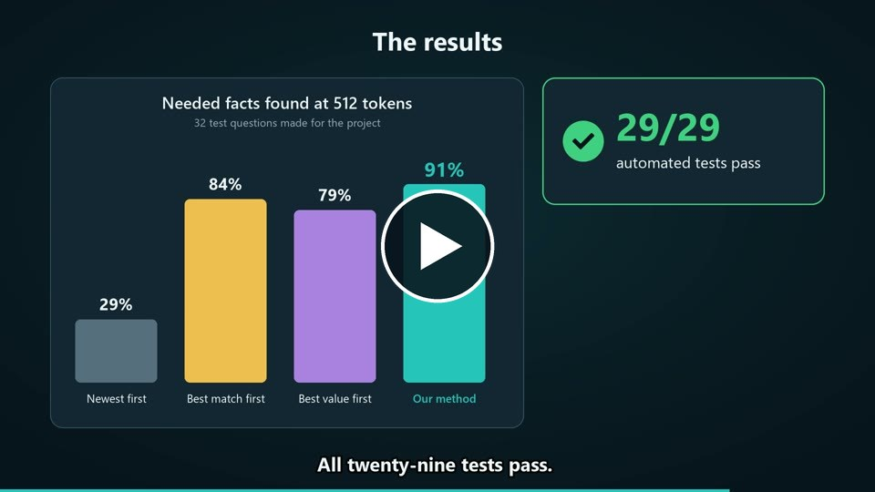

# Context Budget Manager

An AI agent can only read a limited amount of text before it answers. A retriever usually hands it far more than fits, so something has to decide what goes in. This project is that decision: a C++17 module that picks and orders passages under a hard token budget, built on data structures we wrote ourselves.

It is our Complex Engineering Problem for CS-251 Data Structures and Algorithms at MUET Jamshoro (Batch 25CS, Dr. Ali Asghar Manjotho).

## Watch the 2-minute explainer

[](https://waqas-ali-rajput.github.io/context-budget-manager/)

Click the picture to watch it in your browser, or [download the video](https://github.com/waqas-ali-rajput/context-budget-manager/raw/main/docs/video/cep/CEP_video.mp4) (MP4, 8.5 MB).

## How it works

We compare four ways of choosing passages:

| Policy | Picks passages by |
|---|---|
| Recency-first | Newest first |
| Relevance-first | Highest retriever score first |
| Relevance-per-token | Score divided by token cost |
| **Hybrid fresh-cover** (ours) | Removes replaced notices, then repeatedly takes the passage with the most new evidence per square root of its cost |

Mandatory passages always go in first. If they cannot all fit, the program returns `INFEASIBLE` and says why, and it never drops one silently.

We wrote these ourselves: a binary heap, merge sort, a linked list with list merge sort, and an open-addressing hash map. No `std::sort`, `priority_queue` or `unordered_map` is used.

## Results

Mean share of the needed facts found, on 32 labelled questions and 1,300 passages:

| Context budget | Recency | Relevance | Per-token | **Hybrid** |
|---|---:|---:|---:|---:|
| 256 tokens | 0.231 | 0.544 | 0.631 | **0.792** |
| 512 tokens | 0.286 | 0.842 | 0.792 | **0.908** |
| 1,024 tokens | 0.603 | 0.950 | 0.967 | **1.000** |

- **Budget safety:** 0 violations in 24,704 runs across all policies, and 29 of 29 automated tests pass.
- **Freshness and copies at 512 tokens:** the hybrid selected 0 replaced passages and 0 redundant copies. Relevance-first selected 56 and 82.
- **Speed and memory:** the hybrid costs more, at about 16 µs against 6 to 7 µs for about 41 candidates, and six to ten times the auxiliary memory.
- **Where it loses:** on multi-source questions at 512 tokens, relevance-first answered more facts. At very small budgets the hybrid can skip a needed longer notice.

Answer quality was measured with two offline agents as a proxy, not with a real language model. The main dataset is synthetic, and the MUET document set is mostly written by the team, so these rules are test data and not official MUET policy. The [report](docs/CEP_Report.pdf) covers these limits.

## Run it

You need `g++` with C++17. Nothing here calls a paid service or the network.

On Windows, from the `cep` folder:

```bat
run_demo.bat
```

This builds the program if needed and opens an interactive menu. To build and run the tests by hand:

```bat
build.bat
cbm test
```

On Linux or macOS, use `make` and then `./cbm test`.

Other commands, each writing its output to `cep/results/`:

```bat
cbm eval
cbm edge
cbm muet
cbm bench --reps 9
```

## What is in here

| Path | Contents |
|---|---|
| [`cep/src`](cep/src) | C++ source, including the data structures and tests |
| [`cep/data`](cep/data) | Labelled scenarios, passages and edge-case fixtures |
| [`cep/results`](cep/results) | Raw outputs behind every reported number |
| [`data`](data) | MUET document set that `cep/scripts/muet_dataset.py` converts |
| [`docs/CEP_Report.pdf`](docs/CEP_Report.pdf) | Engineering report |
| [`docs/CEP_Solved.pdf`](docs/CEP_Solved.pdf) | Detailed solved document with all tables and screenshots |
| [`docs/CEP_Presentation.pptx`](docs/CEP_Presentation.pptx) | Presentation |
| [`docs/video/cep`](docs/video/cep) | Explainer video, script and render files |

## Team

| Member | Roll number | Main responsibility |
|---|---|---|
| Waqas Ali (lead) | 25CS061 | Hybrid policy, hash map, lazy heap, packaging, demo |
| Mehran Ali | 25CS009 | Loader and validation, baselines, budget tests |
| Gaffar | 25CS067 | Labelled dataset and edge cases |
| Basit Azam | 25CS113 | Complexity analysis and scaling benchmark |

## AI use

The code, dataset generator, experiments and documents were produced with the help of an AI coding assistant (Claude, Anthropic) under the team's direction.
